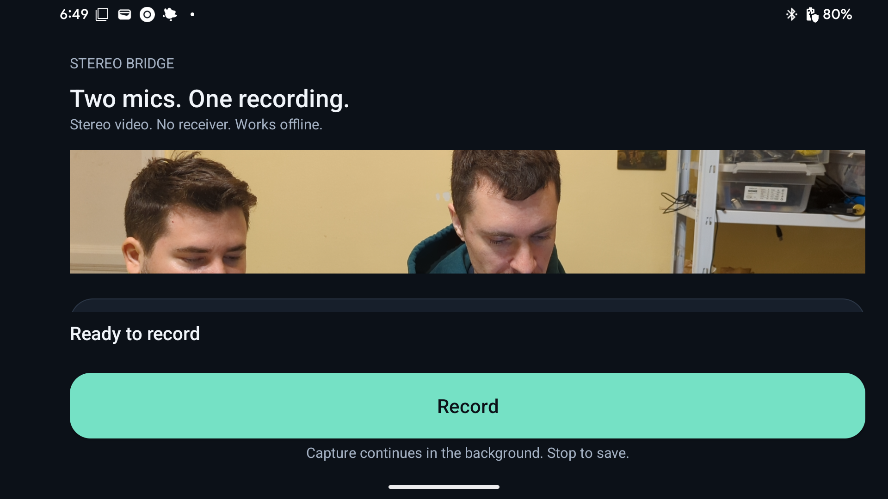

# Stereo Bridge

**Two wireless mics. One stereo video. No receiver.**

An open-source Android recorder that connects directly to two original DJI Mic Mini transmitters and saves each microphone on its own audio channel alongside camera video.

[Get started](docs/usage.md) · [Compatibility](docs/compatibility.md) · [How it works](docs/architecture.md) · [Build](docs/build.md) · [Download candidate](https://github.com/w1ne/stereo-bridge/releases/tag/v0.2.0-offline-rc4) · [Google Play](https://play.google.com/store/apps/details?id=app.stereobridge)

## Why Stereo Bridge?

For interviews, conversations and two-person recordings, separate microphone channels let you adjust each voice independently in your editor. Stereo Bridge keeps the setup small: your phone and two transmitters. The app decodes audio locally and records video with its own camera screen.

- **Separate voices:** one mic on the left channel, one on the right; independent meters, gain, mute and channel swap.
- **Camera quality where the hardware allows (unreleased candidate):** 4K30/4K60/1080p60/1080p30, video stabilization, tap-to-focus, zoom, torch, camera flip, and 10-bit HDR on supporting devices.
- **One-button capture:** with both paired mics powered on, open the app and tap **Record**. Tap **Stop** to save to **Movies / Stereo Bridge**.
- **Offline by design:** no account, ads, analytics, Internet permission, Wi-Fi or debugging setup.
- **Ordinary permissions:** camera and paired Bluetooth access; recording notifications are optional.
- **Open implementation:** inspect the Bluetooth driver, LC3 decoding and recording pipeline.

## Get started

1. Pair both original DJI Mic Mini transmitters in Android Bluetooth settings.
2. Open Stereo Bridge and grant Camera and Nearby devices access (Android 12+).
3. Tap **Record**, then **Stop**. Use **Open last video** to watch the saved take.

Android 10/11 use ordinary legacy Bluetooth access. Keep Bluetooth enabled and both transmitters powered on. Setup and controls survive phone reboots; recording starts only when you tap Record. Camera features are negotiated from advertised capabilities, so non-Pixel Android 10+ phones keep working with the best modes and controls their hardware supports.

## Release status

**0.2.0-offline-rc4** is the current offline recorder candidate. Android 10+, ARM32, ARM64 and x86_64; camera/encoder capabilities select a usable mode from the 4K30/4K60/1080p60/1080p30 matrix with a bounded legacy fallback on devices that lack canonical sizes.

The Google Play link currently serves the earlier **0.1.0-rc3** stock-camera bridge, which requires wireless debugging. The offline update was submitted to Google Play on 14 October 2026 and is in the review queue; it is not yet live. [Release status and verification](docs/offline-verification.md) distinguish each version and its test results.

Physical microphone testing uses **Pixel 6 / Android 15** and **two original DJI Mic Mini transmitters**. Other phones require validation. DJI Mic, DJI Mic 2, Mic Mini 2 and other manufacturers are unsupported. See [compatibility and known limits](docs/compatibility.md).

## Repository map

| Path | Purpose |
| --- | --- |
| [`app/`](app/) | Android UI, recording service, microphone transport, native codec and unit tests |
| [`docs/`](docs/README.md) | Usage, compatibility, architecture, build and verification guides |
| [`third_party/`](third_party/) | Vendored Google liblc3 source, upstream revision and license |
| [`scripts/`](scripts/) | Synthetic emulator capture and MP4 verification tools |
| [`store/`](store/) | Play listing source and store assets |
| [`.github/`](.github/) | Build/emulator CI, website deployment and issue templates |
| [`docs/site/`](docs/site/) | Public product page and versioned privacy policies |

## Contribute and support

Start with [building the app](docs/build.md), [contributing](CONTRIBUTING.md), or [reporting a bug](https://github.com/w1ne/stereo-bridge/issues/new/choose). Include the app version, phone/Android version and microphone model. Keep personal recordings and full phone logs private.

[Privacy](PRIVACY.md) · [Security](SECURITY.md) · [License](LICENSE) · [Third-party notices](THIRD_PARTY_NOTICES.md)

Apache-2.0 application source; Google liblc3 retains its license. Independent project, not affiliated with or endorsed by DJI. Published by Artomatica. Support: andrii@shylenko.com.
