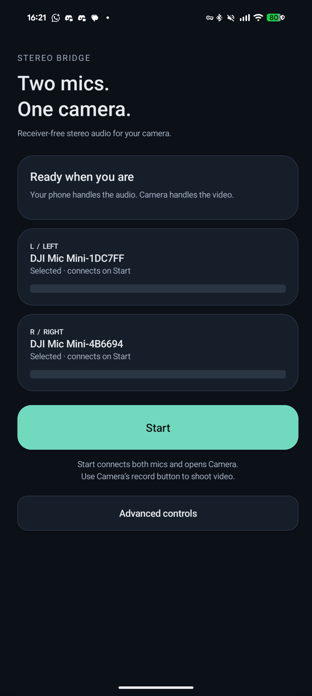

# Stereo Bridge

**Two mics. One camera.** Open-source Android audio routing for two original DJI Mic Mini transmitters without a receiver. Audio decoding and mixing run on the phone. Video stays in your camera app.



## Get started

1. Pair both transmitters in Android Bluetooth settings.
2. Tap **Start**. Stereo Bridge selects exactly two paired microphones and guides you through permissions and first-time camera routing setup.
3. Camera opens when both inputs are live. Use Camera’s record button to shoot video.
4. Tap **Stop** in Stereo Bridge or its notification when finished.

Gain, mute, channel selection, swapping and an audio-only preview are under **Advanced**. The interface follows your phone’s light or dark theme.

[Downloads](https://github.com/w1ne/stereo-bridge/releases) · [Setup and privacy](https://w1ne.github.io/stereo-bridge/) · [Report an issue](https://github.com/w1ne/stereo-bridge/issues)

## Compatibility and release status

**Release candidate: 0.1.0-rc2.** Tested configuration: Pixel 8 Pro, Android 17, stock Pixel Camera and two original DJI Mic Mini transmitters. Other phones, Android versions and camera apps remain unverified. Other DJI microphone generations and other manufacturers are unsupported.

Independent capture and decoding produced user-confirmed recognizable speech. A signed standalone build routed two distinct inputs into a stock-camera 51-second 4K stereo video. The latest candidate adds system-theme UI and session hardening; final camera speech playback and a full disconnect/Stop exercise on this exact candidate remain pending. See [verification notes](docs/release-verification.md). Store availability is pending; this is not a claim of Google Play approval.

Camera routing needs user-authorized **Wireless debugging**. Enable Developer options and Wireless debugging while connected to Wi-Fi; pair the app locally using Android’s six-digit code. Keep Wireless debugging enabled for camera sessions. No receiver, root, Shizuku, DJI software or computer runtime is required. Normal Android application permissions alone cannot register the camera audio injector. Changing networks or rebooting may require reconnection through Camera setup.

Allow notifications to see connection failures while Camera is foreground. If notifications or the alert channel are disabled, those alerts may be absent. The app does not automatically restart microphones after a failure. Precise inter-microphone clock synchronization and drift correction have not been validated.

## Build

JDK 17, Android SDK 36, NDK 28.2.13676358 and CMake 3.22.1. Gradle 9.6.0 is pinned by the wrapper with a SHA-256 distribution checksum.

```sh
./gradlew testDebugUnitTest lintRelease assembleDebug bundleRelease
```

Application ID: `app.stereobridge`; debug variant adds `.debug`. Release signing is optional for local builds. To sign, set `STEREO_BRIDGE_SIGNING_PROPERTIES` to an external properties file containing `storeFile`, `storePassword`, `keyAlias` and `keyPassword`. Keep all credentials outside this repository. Private recordings, lab logs, keys and local SDK settings are ignored.

The packaged routing helper runs through an authenticated local ADB connection. No executable code is downloaded at runtime. Buffers are bounded; Stop cancels pending capture and routing work, and errors require explicit user retry. Current regression suite: 31 tests.

## Project

[Privacy](PRIVACY.md) · [Third-party notices](THIRD_PARTY_NOTICES.md) · [Driver notes](docs/independent-driver-research.md) · [Contributing](CONTRIBUTING.md) · [Security](SECURITY.md)

Apache-2.0 application source; bundled libraries retain their respective licenses. Independent project, not affiliated with or endorsed by DJI. Support: andrii@shylenko.com.
