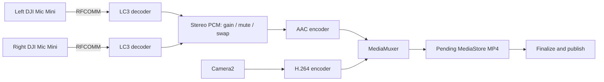

# Architecture

Stereo Bridge uses ordinary Android APIs to record video in its own camera screen. Both microphones have independent Bluetooth connections and decoders.

## Source map

Paths below are under `app/src/main/java/app/stereobridge/`.

| Component | Responsibility |
| --- | --- |
| `MainActivity`, `Ui`, `PermissionPromptPolicy` | One-button flow, preview, theme and ordinary permission recovery |
| `OfflineRecorderService`, `OfflineSessionState` | Explicit capture lifecycle, foreground service, resources and state |
| `mic/DjiMicSource`, `mic/DjiPacketParser`, `mic/NativeLc3` | Paired RFCOMM transport, packets and independent native LC3 decode |
| `StereoPcmMixer`, `PcmTimeline`, `PcmBatchQueue` | Channel processing, sample timestamps and encoder batching |
| `OfflineVideoEncoder`, `EncoderMuxGate`, `EncoderReleaseBarrier` | Codec negotiation, muxing and safe finalization |
| `CameraGeometry`, `VideoCapabilityPolicy`, `StartupRetryPolicy` | Orientation, capability checks and bounded startup retries |
| `RecordingStore`, `PendingRecordingJournal`, `Mp4AtomProbe`, `OpenCaptureRegistry` | Scoped storage, restart recovery and descriptor ownership |

Native code lives in `app/src/main/cpp/`; unit tests mirror the helpers under `app/src/test/`.

## Lifetime and recovery

Recording begins only after an explicit Record action. Stop closes microphone/camera producers, drains encoders and publishes the completed app-owned video. Camera closure and encoder release precede descriptor closure or recovery. A journal remembers pending captures; recovery validates ownership and MP4 structure, removes known unusable pending captures and retains uncertain or finalized output for retry.

Queues and startup retries are bounded. Short packet loss uses LC3 concealment; ambiguous large discontinuities stop the take and attempt a partial save. No network service, Android AudioRecord input or virtual audio-device injection is used.
